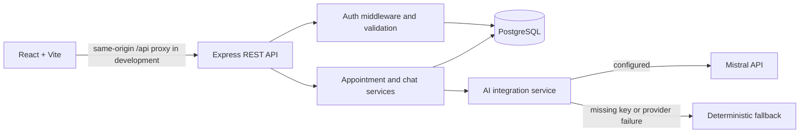

# Wellnest Appointment Assistant

A full-stack prototype for the Senior Full Stack Developer technical assessment. It combines a React member portal, an Express REST API, PostgreSQL persistence, cookie-based JWT authentication, and an AI-assisted chat service with a deterministic fallback.

This is an assessment prototype, not a clinical system. Do not enter real patient information.

## What’s included

- **Frontend:** responsive member dashboard, signup/sign-in, appointment list and booking form, chat panel, account view, async loading/error states.
- **Backend:** Express API, bcrypt password hashing, HttpOnly JWT cookie, Zod request validation, per-user ownership checks, structured HTTP errors, request logging, and rate limiting.
- **AI:** Mistral chat-completions integration when `MISTRAL_API_KEY` is configured; a deterministic fallback when no key is present or a provider request fails. Conversation context is stored and limited to the most recent 12 messages per request.
- **Database:** PostgreSQL DDL, tenant-aware relationships, indexes and constraints, a seed script, and sample SQL for appointments and chat history.

## Architecture



The API owns validation, identity, persistence, and appointment writes. The AI service may suggest structured booking details, but it never creates an appointment; the member reviews and submits the booking form, and the API validates the final request.

## Project structure

```text
.
|-- frontend/
|   |-- src/App.tsx                 Auth gate and member dashboard
|   |-- src/AuthScreen.tsx          Sign-in and signup
|   |-- src/api.ts                  Typed API client
|   |-- src/wellnest.css            Responsive interface styles
|   `-- package.json
|-- backend/
|   |-- database/schema.sql         PostgreSQL DDL and indexes
|   |-- database/sample-data.sql    Repeatable example appointment/chat inserts
|   |-- src/routes/                 Auth, appointment, and chat REST routes
|   |-- src/services/ai.ts          Mistral adapter and deterministic fallback
|   |-- src/db/                     Pool, migration, and seed commands
|   |-- tests/ai.test.ts            Provider-free assistant behavior tests
|   `-- package.json
|-- docker-compose.yml              Local PostgreSQL service
`-- README.md
```

## Run locally

Prerequisites: Node.js 20.19+ or 22.12+, npm, and Docker Desktop with its Linux container engine running (or a local PostgreSQL 16 instance).

1. From the repository root, start PostgreSQL:

   ```powershell
   docker compose up -d postgres
   ```

   Compose exposes PostgreSQL on host port `5433` to avoid colliding with an existing local PostgreSQL service on `5432`.

2. Copy the backend environment template and set a unique local JWT secret:

   ```powershell
   Copy-Item backend/.env.example backend/.env
   ```

   The default local database URL matches `docker-compose.yml`. If using your own PostgreSQL instance instead, set `DATABASE_URL` to its host, port, database, and credentials. Add `MISTRAL_API_KEY` to `backend/.env` to enable real Mistral requests; leave it blank to use the fallback. Keep `.env` files private and never put provider keys in the frontend.

3. In a terminal, install dependencies, create the schema, seed the demo clinic/account, and start the API:

   ```powershell
   cd backend
   npm install
   npm run db:migrate
   npm run db:seed
   npm run dev
   ```

   The API listens on `http://localhost:3001`. The health endpoint is `http://localhost:3001/api/health`.

4. In a second terminal, start the frontend:

   ```powershell
   cd frontend
   npm install
   npm run dev
   ```

   Open the Vite URL, normally `http://localhost:5173`. Vite proxies `/api` to the backend. For a separate frontend/API origin, set `VITE_API_URL` and configure `FRONTEND_URL` in the backend environment.

The seed command creates a local demo user. Defaults are `alex@example.test` / `WellnestDemo2026!`; override them with `DEMO_USER_EMAIL` and `DEMO_USER_PASSWORD` before seeding. These credentials are for local evaluation only.

To insert the documented example appointment and conversation records after seeding, run `backend/database/sample-data.sql` against the `wellnest` database. The seed command already creates a small appointment list for the demo account.

## Verification

```powershell
cd backend
npm test
npm run build
```

```powershell
cd frontend
npm run lint
npm run build
```

Database-backed startup and API workflows require PostgreSQL. The included AI fallback tests do not require a database or provider key. A real Mistral request requires a privately configured API key.

## API overview

All routes are prefixed by `/api`. Signup and login set an HttpOnly `wellnest_session` cookie; authenticated routes require that cookie. Browser requests include credentials.

| Method | Route | Purpose |
| --- | --- | --- |
| `GET` | `/health` | Checks PostgreSQL connectivity and reports whether AI uses Mistral or fallback |
| `POST` | `/auth/signup` | Create account (`fullName`, `email`, `password`) |
| `POST` | `/auth/login` | Sign in (`email`, `password`) |
| `GET` | `/auth/me` | Get the current account |
| `POST` | `/auth/logout` | Clear the session cookie |
| `GET` | `/appointments` | List the current member’s appointments |
| `POST` | `/appointments` | Create an appointment (`service`, `clinician`, `startsAt`) |
| `PATCH` | `/appointments/:id/cancel` | Cancel an owned scheduled appointment |
| `GET` | `/chat/sessions/current` | Reuse the member’s latest conversation or create one |
| `POST` | `/chat/sessions` | Create a new conversation |
| `GET` | `/chat/sessions/:sessionId/messages` | Retrieve conversation history |
| `POST` | `/chat/sessions/:sessionId/messages` | Persist a user message and generate an assistant response |

Validation errors return `400`, unauthenticated requests `401`, conflicting slots `409`, missing resources `404`, and unexpected server failures `500`, with a consistent `{ "error": { "code", "message" } }` body.

## Database notes

`backend/database/schema.sql` defines:

- `businesses` for the organization boundary.
- `users` with normalized unique email and a bcrypt password hash.
- `appointments` with user/business ownership, UTC `starts_at`, and constrained status.
- `chat_sessions` for conversation metadata and update time.
- `chat_messages` for normalized, ordered user/assistant history and extracted AI intent.

Indexes support user schedule retrieval, business schedule/status filtering, active slot uniqueness, recent session lookup, and ordered message retrieval. Foreign keys cascade member-owned data and prevent cross-business ownership mismatches. The provider-slot uniqueness constraint only catches identical start times; it does not model appointment duration or provider working hours.

## Authentication, privacy, and AI

Passwords are hashed with bcrypt. JWTs are signed server-side and placed in an HttpOnly, SameSite=Lax cookie; cookies are Secure in production. CORS uses the configured frontend allowlist. Signup/login, chat, and general API routes have basic in-memory rate limits. The logger records request metadata and AI provider/intent metadata, not chat message bodies.

When configured, the API sends recent chat text to Mistral and validates the returned JSON with Zod. Provider errors, invalid output, or an absent key use the local fallback. The fallback recognizes only simple explicit booking phrases and extracts an ISO date/time when present. Missing details route the member to the structured form. No model response is treated as medical advice or as authorization to book.

For deployment, use HTTPS, a unique `JWT_SECRET` of at least 32 characters, managed PostgreSQL, and a server-only Mistral key. The cookie settings assume frontend and API are same-site; cross-site hosting needs deliberate cookie/CSRF configuration in addition to credentialed CORS.

## Assumptions and limitations

- This prototype seeds one demo clinic, while the schema carries `business_id` for tenant boundaries.
- Providers and offered times are static form choices. There is no calendar integration, duration-based overlap detection, timezone policy, or real availability lookup.
- Chat uses request/response REST calls rather than WebSockets; it is near-real-time and keeps multi-turn context in PostgreSQL.
- Password reset, email verification, roles, account deletion, and production session revocation are not implemented.
- The fallback assistant is intentionally limited. Mistral behavior was not live-tested without a supplied provider key.
- The UI is an assessment prototype and is not HIPAA/security certified or suitable for real health data.
- This workspace is not pushed to GitHub or deployed. Publishing requires the owner’s repository and hosting credentials; no live demo URL is available yet.

## Key tradeoffs

- **HttpOnly cookie instead of browser storage:** protects the JWT from direct JavaScript reads; same-site deployment and CORS are documented requirements.
- **AI intent is advisory:** structured details are stored for inspection, while appointment creation stays on the validated API path.
- **Normalized messages instead of a JSON transcript column:** supports chronological paging, per-message AI metadata, and useful indexes.
- **Prototype scope over scheduling complexity:** exact-slot uniqueness prevents a narrow class of collisions without pretending to implement a full calendar engine.
